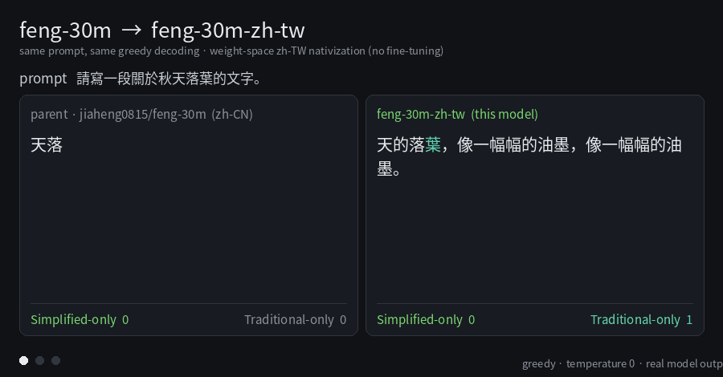

## zh-TW variant: native Traditional Chinese, built by weight-space programming

This fork carries a **native Traditional-Chinese (zh-TW)** conversion of feng-30m, in `zh_tw/`.
It is a deterministic **weight-space** transform — no fine-tuning, no adapter, no runtime
converter, no GPU. Exactly one tensor changes, `model.embed_tokens.weight` (the tied
embedding/unembedding), on 6945 of 16384 rows; every other tensor, the file size, shapes, dtypes
and the 16384-token vocabulary are unchanged, so the architecture, the tied-embedding assumption
and the on-device C/ESP32 compatibility of the parent all survive.

Model weights + card: **[hf.co/Luigi/feng-30m-zh-tw](https://huggingface.co/Luigi/feng-30m-zh-tw)**.

### Demo — same prompt, same greedy decoding



Real model output, temperature 0, unedited. **Red** = Simplified-only glyph, **teal** =
Traditional-only glyph, counters computed live from Unihan classes.

| prompt | parent (zh-CN) | feng-30m-zh-tw |
|---|---|---|
| 請寫一段關於秋天落葉的文字。 | 秋天**落叶**，**叶子变黄**，**叶子变黄**。 | 秋天的**落葉**，像一幅幅的油墨，像一幅幅的油墨。 |
| 請介紹故宮的歷史。 | 史前古城，是古今古城里最著名的建**筑**之一。 | 史前**宮**是史前**宮**的官方**宮殿**，由**宮殿**、**宮殿**和**宮殿**等史前**宮殿**所共同管理。 |
| 太陽為什麼會東升西落？ | 我只能看到**当前这段对话**，之前的聊天我**记**不住。 | 我只能看到你之前的回答，所以只想把「山」和「山」的 |

Over a fixed 16-prompt × 64-token greedy audit:

| generated-text metric | parent | feng-30m-zh-tw |
|---|---|---|
| Simplified-only glyphs per 100 Han chars | **20.73** | **0.00** |
| Traditional-only glyphs per 100 Han chars | 0.78 | **4.93** (6.3×) |
| prompts leaking ≥1 Simplified-only glyph | 13 / 16 | **0 / 16** |

The parent is a 29M model: outputs are repetitive and often incoherent. The demo is about *script
fidelity*, not fluency — the parent's quality ceiling is inherited unchanged.

### Perplexity on seven held-out zh-TW domains

1024 tokens per slice; domains 3–7 are fresh Wikipedia articles, verified 12-gram-disjoint from
the eval slices and from the conversion's attestation corpus, and never used to choose a knob.

| domain (topic) | parent | feng-30m-zh-tw | Δ |
|---|---|---|---|
| eval1 · Wikipedia | 202.27 | **169.00** | −16.4% |
| eval2 · Wikipedia (other domain) | 313.33 | **212.74** | −32.1% |
| val3 · fresh articles | 232.19 | **165.69** | −28.6% |
| val4 · geography / sport | 331.27 | **296.84** | −10.4% |
| val5 · culture / food | 140.65 | **138.22** | −1.7% |
| val6 · science / history | 327.29 | **268.01** | −18.1% |
| val7 · science / medicine | 217.43 | **184.56** | −15.1% |
| **mean CE, six tuning domains (nats)** | 5.508 | **5.302** | **−3.7%** |

### How zh-TW-ness is measured

Three independent instruments, because no single one is trustworthy on its own.

1. **Fluency in the target variety.** Primary metric = mean cross-entropy (nats/token) over six
   held-out zh-TW domains, plus per-domain perplexity. A seventh domain is a *generalization
   guard*: measured every run, never optimized. Every candidate edit is scored on all of them; a
   win that hurts the guard is rejected as slice-overfitting. This is how several knob values that
   looked optimal on two slices (word gate, character-transfer strength) had to be re-selected.
2. **Purity — the zh-TW rate of what it emits.** Glyphs are classified with Unihan
   (`s_exclusive` / `t_exclusive`), minus the dual-use glyphs (台/里/著/学 …) that a zh-TW corpus
   proves are legitimately used in Traditional text.
   *Behavioural*: count Simplified-only glyphs in generated text — **0** here, vs 20.73 per 100 Han
   chars for the parent. *Structural*: an id is a leak if the string it emits contains a
   Simplified-only glyph **and** its row survives at full strength (`‖row‖/‖parent row‖ > 0.9`);
   bound ≤ 200, measured **1** (an attested dual-use glyph), 0 unattested.
3. **Controls, to prove the gain is language identity and not a temperature trick.** A zh-CN probe
   (21k Simplified chars) and an English probe (22k chars) are measured with every structural
   change. The zh-CN probe must **not** improve: 220 → **769** here (deliberately much worse).
   The English probe must not improve materially: 43.60 → 42.81.

The controls earned their keep. Raising the Simplified-suppression scale from 0.32 to 0.56
improves mean CE by 0.15% and drops the zh-CN control from 754 to **394** — it buys perplexity by
restoring Simplified emission. That lever, a global tied-embedding scale, and boosting non-Han
rows (English improved 4.9%) are all **softmax-temperature disguises**: they help any text, so
they are rejected even when every fluency number improves.

### Weight-space programming, in this repo

The conversion is a program, not a training run:

```
(E_parent, tokenizer, Unihan, zh-TW corpus, knobs)  →  (E_new, renamed_vocab, manifest)
```

No gradients, no epochs, no data pipeline: **the search is over edits, not over weights**, and the
interpreter is the model itself — each edit is compiled by running it and scored by the three
instruments above. Invariants act as the type system (only `embed_tokens` may differ;
size/shapes/dtype/vocab fixed; the ≤0.9 purity bound), and the program prints every accepted
decision, so the artifact is auditable:

```
[tw] word-swaps 671  word-renames 2275  word-leaks 1207  char-twins 441
[tw] pieces unique; 0 unassignable ids turned into dead clones
[tw] merges: live in parent 16124, kept after rename 12685 (78.7%)
[tw] TRAD_BOOST 1.1 applied to 4418 native-only emitters, ren-branch 2914
[tw] Simplified-emitting ids: 2879 shadowed (L-scaled), 0 full-strength (word leaks)
```

Five primitives, each acting on a *population* of ids chosen by predicates (glyph sets, corpus
attestation, row geometry `cos`, row norm):

| primitive | what it does | accepted here |
|---|---|---|
| `swap(w, k)` | `w` and its Traditional twin token `k` exchange strings; the Traditional spelling is served by `w`'s trained row | 671 |
| `rename(w → c)` | give `w` a Traditional spelling `c` that has no token of its own | 2275 |
| `transfer(src → dst, s, gate)` | `dst`'s row takes fraction `s` of `src`'s **direction**, at `dst`'s own norm | 441 char rows, s = 0.20 / 0.40 |
| `suppress(pop, L)` | rows emitting Simplified-only glyphs → `L ×` their row | 2879 ids, L = 0.32 |
| `boost(pop, g)` | rows emitting genuinely Traditional glyphs → `g ×` their row | 4418 ids, g = 1.10 / 0.70 |

Because the embedding is **tied**, every edit changes both what the model prefers to emit
(unembedding) and how it reads a token in context (embedding). That coupling is why naive edits
fail here: suppressing a row harder to kill a Simplified emission also destroys the model's
ability to *read* that token — which is what makes the tied case harder than a vocab swap on an
untied output head.

Two principles did most of the work:

1. **String/row provenance** — a token must be served by the row trained on the string it now
   emits. Auditing every place a row serves a foreign string found one violation in the swap
   branch (a swapped-off Simplified string was being served by the Traditional token's row);
   fixing it improved all seven domains at once *and* degraded the zh-CN control, the signature of
   a genuine nativization.
2. **Corpus attestation** — a rename or glyph transfer is dropped when a 130k-char eval-disjoint
   zh-TW corpus evidences the other form. This kills the classic per-word dictionary failure modes
   (皇后 → 皇后, 輪廓 → 輪廓) that pure Unihan mapping introduces.

Negative results are the substance of the method (~125 scored experiments). Row vectors in this
model are **not composable and not propagatable**: nearest-neighbour transfers, char-composition
of word rows, word donors for character rows, and vocabulary extension (new ids for untokenised
zh-TW words with merges appended) all measurably hurt; the character transfer only works from the
**exact** Simplified twin. The softmax is extremely norm-sensitive (a norm-proportional boost:
5.31 → 6.31 nats), so the only usable boost shape is a constant per population — glyph-count-,
frequency- and norm-graded variants were all worse. Tokenizer-side ideas are inert by
construction: renaming is a decode-side string edit, so the parent's tokenization is untouched and
no merge-rule change can move the metric. Suppression *algebra* is inert too (only its scale
matters), because this 16k vocabulary has almost no Traditional single-char tokens — there is no
twin row for a leak to align to.

Cost: the final program runs in ~15 s on CPU, 0 GPU-seconds, deterministic, and writes
`manifest.json` with the parent SHA-256, every knob value and the algebra.

### Reproduce

```bash
pip install safetensors numpy tokenizers transformers
python zh_tw/build_tw.py --base /path/to/feng-30m --out ./feng-30m-zh-tw
python zh_tw/eval_ppl.py --model ./feng-30m-zh-tw --text your_zh_tw_text.txt
python zh_tw/make_demo.py          # regenerates assets/demo.gif from real generations
```

Load and generate:

```python
from transformers import AutoModelForCausalLM, AutoTokenizer
m = "Luigi/feng-30m-zh-tw"
tok = AutoTokenizer.from_pretrained(m)
net = AutoModelForCausalLM.from_pretrained(m, trust_remote_code=True, dtype="float16").eval()
prompt = "請介紹故宮的歷史。"
ids = tok(prompt, return_tensors="pt")["input_ids"]
print(tok.decode(net.generate(ids, max_new_tokens=64, do_sample=False)[0][ids.shape[1]:],
                 skip_special_tokens=True))
```

### Limitations

* **Not a good zh-CN model any more** — by design (zh-CN PPL 220 → 769). Use the parent for Simplified.
* The parent's `esp32/` export is deliberately **not** shipped for the variant: it quantises the
  parent's embedding and is stale. Re-export it from the converted `model.safetensors`.
* Gains are domain-dependent — culture/food (val5) is nearly at the parent's level, because the
  character transfer that makes spelling native costs a little in-domain fluency there.
* Vocabulary and merges are the parent's: ~21% of merge rules leave the reachable set after
  renaming and untokenised zh-TW words stay character-split (vocabulary extension was measured to
  break tokenisation).

See `zh_tw/MODEL_CARD.md` for the full model card.
